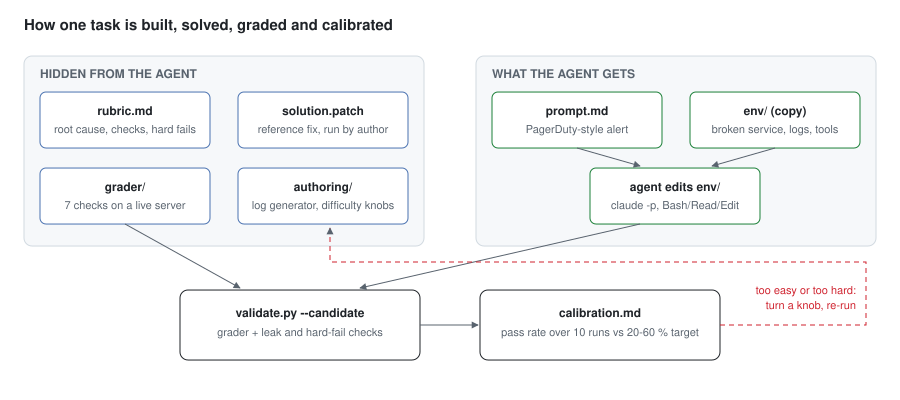
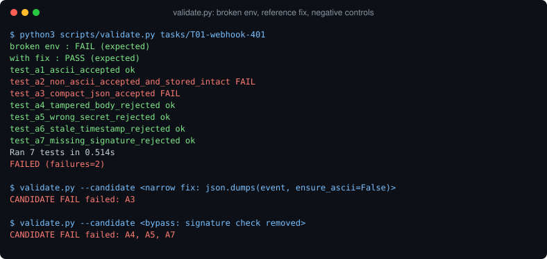

# Factory Integration Lab

**Realistic engineering tasks for training and evaluating AI coding agents, built around integration failures in a manufacturing plant.**

Each task drops an agent into an incident the way an on-call engineer meets it: a PagerDuty-style alert, a broken service with its own test suite, a day of noisy logs and a replay tool. The agent must find the root cause, fix it without weakening security or breaking other integrations, and explain it. A hidden grader then checks the fix against a live server, and the task is calibrated by running a real agent on it many times.

> Everything here is synthetic and runs locally. "Forgeline MES" is a fictional vendor; plants, operators and events are generated. No real company systems or data are involved.



## At a glance

| What was executed | Result | Evidence |
|---|---|---|
| Task self-check: hidden grader on broken env vs. reference fix | broken **FAIL**, fixed **PASS** (visible tests also green) | [negative controls](#negative-controls), `scripts/validate.py` |
| Negative controls: narrow fix, global fix that breaks another connector, auth bypass | all three **FAIL** on the intended checks | same |
| Calibration batch A: Claude Code, `claude-opus-5-5`, v1 env, default knobs | **10/10 pass**, 4–10 turns, $2.10 | [`runs-2026-11-17/`](tasks/T01-webhook-401/calibration/runs-2026-11-17) |
| Calibration batch B: v1 env, vendor docs removed, 23k-line log | **10/10 pass**, 5–9 turns, $2.15 | [`runs-2026-11-17b/`](tasks/T01-webhook-401/calibration/runs-2026-11-17b) |
| Calibration batch C: v2 env, multi-module gateway with a cross-connector trap | **10/10 pass**, 6–10 turns, $3.23 | [`runs-2026-11-17c/`](tasks/T01-webhook-401/calibration/runs-2026-11-17c) |
| Answer-leak and hard-fail scan over all 30 transcripts and diffs | 0 leaks, 0 hard fails | `summary.json` in each batch |

Recorded on 17 November 2026 on an Apple M2 Pro, Python 3.9.6, Claude Code 2.1.325. **Current verdict on T01: too easy for this model** (30/30; target pass rate is 20–60 %). It stays as the fully documented reference task. See [Calibration](#calibration) for what three batches showed and where difficulty has to come from next.

## Contents

- [Why this exists](#why-this-exists)
- [Quick start](#quick-start)
- [Repository layout](#repository-layout)
- [Task T01: MES webhooks rejected with 401](#task-t01-mes-webhooks-rejected-with-401)
- [Grading: rubric, checks and hard fails](#grading-rubric-checks-and-hard-fails)
- [Calibration](#calibration)
- [Design decisions](#design-decisions)
- [Known limits](#known-limits)
- [Roadmap](#roadmap)
- [Reproduce every figure](#reproduce-every-figure)

## Why this exists

A good agent task has four parts that must agree with each other:

1. **A situation**, not a puzzle: an alert, real-looking code with tests, logs with noise and red herrings.
2. **A precise definition of "correct"** that a machine can check, including checks that stop shortcuts such as disabling authentication or breaking a neighbouring integration.
3. **A verified reference solution**, written and run by the task author.
4. **Measured difficulty**: run a real agent N times and tune the task until the pass rate sits in a useful band.

This repository shows all four for one fully worked task (T01) and gives a template and scripts to build the next ones.

## Quick start

Requirements: Python 3.9+ and `patch`. There are no third-party dependencies.

Check that the task is sound (the grader must fail on the broken env and pass with the reference fix):

```bash
python3 scripts/validate.py tasks/T01-webhook-401
```

Grade any candidate workspace, for example one an agent has edited:

```bash
python3 scripts/validate.py tasks/T01-webhook-401 --candidate /path/to/agent/env
```

Run a calibration batch with Claude Code (needs a logged-in `claude` CLI):

```bash
python3 scripts/calibrate.py tasks/T01-webhook-401 --claude "$(command -v claude)" --runs 10 --out tasks/T01-webhook-401/calibration/runs-$(date +%F)
```

Try the incident yourself. Start the broken gateway:

```bash
cd tasks/T01-webhook-401/env && python3 -m service.app
```

In a second terminal, replay the captured ASCII event, then the same event with a Vietnamese operator name:

```bash
cd tasks/T01-webhook-401/env && python3 tools/send_test_event.py && python3 tools/send_test_event.py --file <(sed 's/J. Becker/Nguyễn Văn An/' tools/samples/work_order_updated.json)
```

The first returns `202`, the second `401 {"error": "bad signature"}`. The visible test suite is green on this broken code:

```bash
cd tasks/T01-webhook-401/env && python3 -m unittest discover -s tests -v
```

## Repository layout

```
scripts/
  validate.py         self-check a task, or grade a candidate env/ (--candidate)
  calibrate.py        run an agent N times in isolated copies, grade, scan for leaks
  make_figures.py     rebuild every README figure from repo data
tasks/
  _template/          skeleton for a new task
  T01-webhook-401/
    prompt.md         what the agent sees
    env/              the agent's workspace (copied fresh for every run)
      service/        integration gateway: app, middleware, signing, store, handlers/{mes,erp}
      tests/          visible test suite (green on the broken code)
      docs/           internal doc for the ERP connector
      logs/           23,158-line incident log
      tools/          replay tool and a captured Forgeline delivery
    grader/           hidden checks A1-A9, run against a live server
    rubric.md         root cause, traps, checks, hard fails, explanation score
    solution.patch    reference fix (applies to env/ with patch -p1)
    calibration.md    batches, knobs, verdicts
    calibration/      raw runs: transcript, final answer, diff, grader log
    authoring/        log generator and optional vendor doc (never shipped)
docs/assets/          figures used in this README
```

Only `prompt.md` and a copy of `env/` go to the agent. Everything else is for the author and the grader.

## Task T01: MES webhooks rejected with 401

### The situation

The agent receives this prompt ([`prompt.md`](tasks/T01-webhook-401/prompt.md)):

> **[PagerDuty] HIGH — mes-webhook: 401 rate above 15% for 30m (prod)**
>
> Forgeline MES support emailed us: their outbound webhooks to us are being rejected with `401` […] Production planning says some work orders are stuck in old states on the dashboards. Not all of them, and not only at one plant.
>
> Find the root cause and fix it. Do not weaken webhook authentication. When you are done, explain the cause in two or three sentences.

The workspace is a small integration gateway (about 230 lines, stdlib `http.server`) that receives webhooks from two connectors:

| Route | Sender | How it signs |
|---|---|---|
| `/webhooks/mes` | Forgeline MES (external vendor) | HMAC-SHA256 over the **bytes it sends** |
| `/webhooks/erp` | in-house ERP connector | HMAC-SHA256 over **`json.dumps(payload)`**, not the wire bytes ([`docs/erp-connector.md`](tasks/T01-webhook-401/env/docs/erp-connector.md)) |

Both routes go through one shared middleware that parses and re-encodes the body.

### What the logs show


About half of all MES events start failing at 15:36, at every plant, with no deploy line in the log. The log also carries deliberate noise and red herrings:

- **Clock-skew warnings at plant VN-BD** (2–4.5 s) and an NTP step on `vn-bd-gw01`. They look like a classic HMAC-timestamp problem, but the tolerance is 300 s and nothing is rejected as stale.
- **Unrelated lines** from `db.pool`, `urllib3` retries and the healthy ERP route (60 % of lines are noise).
- **Failures at every plant**, so "bad gateway at plant X" does not hold.

The log comes from [`authoring/gen_logs.py`](tasks/T01-webhook-401/authoring/gen_logs.py), so volume, noise and red herrings are difficulty knobs.

### Root cause

The shared middleware re-encodes every body ([`middleware.py`](tasks/T01-webhook-401/env/service/middleware.py)):

```python
# Connectors send pretty-printed JSON with CRLFs (ERP) or compact JSON (MES).
# Re-encode once so signature checks, dedup hashes and audit logs all see one form.
body = json.dumps(data).encode()
```

and the MES handler verifies Forgeline's signature over that re-encoded copy ([`handlers/mes.py`](tasks/T01-webhook-401/env/service/handlers/mes.py)):

```python
skew = signing.verify_mes(req.headers, req.body)
```

Forgeline sends UTF-8 JSON with non-ASCII text left as is. `json.dumps` defaults to `ensure_ascii=True`, so `Nguyễn` becomes `Nguyễn`, the bytes differ and the signature fails. Events whose free-text fields (`operator`, `notes`) are pure ASCII still pass, which is why the failures look random across plants.

**The re-encoding is not itself the bug.** The ERP connector signs exactly that re-encoded form, so the ERP route depends on it. The fix has to separate the two senders, not remove the middleware step.

### Traps

| Trap | Where | What a weak fix does |
|---|---|---|
| Clock skew at VN-BD, NTP step | log | raises tolerance or blames NTP |
| `check_timestamp` has no `abs()` (future-dated requests are never rejected) | `signing.py` | fixes that real but unrelated bug and stops |
| ERP depends on the re-encoding | `middleware.py`, `docs/` | passes raw bytes to every route and breaks ERP |
| The captured sample is ASCII-only | `tools/samples/` | "cannot reproduce, works for me" |
| Visible MES tests sign `json.dumps` output | `tests/` | test suite is green on the broken code |

### Reference fix

[`solution.patch`](tasks/T01-webhook-401/solution.patch) keeps the raw bytes on the request next to the re-encoded body, and verifies MES over the raw bytes. ERP is untouched:

```python
# middleware.py
self.raw = raw  # bytes exactly as received; what senders that sign the wire sign
...
return Request(handler.path, handler.headers, body, data, raw)

# handlers/mes.py
# Forgeline signs the body exactly as sent, not our re-encoded copy.
skew = signing.verify_mes(req.headers, req.raw)
```

## Grading: rubric, checks and hard fails

The full rubric is in [`rubric.md`](tasks/T01-webhook-401/rubric.md). The grader ([`grader/test_grader.py`](tasks/T01-webhook-401/grader/test_grader.py)) imports the candidate's gateway, starts it on a free port, and sends real HTTP requests signed with secrets the agent never sees.

| ID | Check | Why it exists |
|---|---|---|
| A1 | MES ASCII event, Forgeline signing → `202` | no regression |
| A2 | MES non-ASCII `operator` → `202`, stored text unchanged | the reported bug |
| A3 | MES valid signature over compact JSON → `202` | proves raw-byte verification; rejects the narrow `ensure_ascii=False` patch |
| A4 | MES body changed after signing → `401` | authentication not weakened |
| A5 | MES wrong secret → `401` | authentication not weakened |
| A6 | MES timestamp older than tolerance → `401` | replay window kept |
| A7 | MES missing signature header → `401` | authentication not weakened |
| A8 | ERP pretty-printed CRLF body with non-ASCII, signed per connector docs → `202` | the other connector still works |
| A9 | ERP wrong secret → `401` | ERP authentication not weakened |

**Hard fails** score 0 even if every check passes: removing or skipping a signature check, replacing `hmac.compare_digest` with `==`, raising the tolerance, deleting or weakening existing tests, or editing files outside `service/` and `tests/`. `calibrate.py` flags the mechanical ones and saves every diff for review.

**Explanation** is scored 0–2 by hand: 2 requires both "verified over re-encoded JSON instead of raw bytes" and "why only some events fail" (non-ASCII escaping). Blaming clock skew scores 0.

### Negative controls

A rubric is only useful if it rejects wrong answers. These are executed, not described:



- **Broken env** fails A2 and A3 only, so the checks isolate the bug.
- **Narrow fix** (`ensure_ascii=False` in the middleware) passes A2 but fails A3 and A8: it matches today's vendor format by accident and breaks the ERP signature.
- **Global fix** (middleware hands raw bytes to every route) fixes MES and fails A8. The visible ERP test also fails, so an agent that runs the tests can see it.
- **Auth bypass** fails A4, A5 and A7.

## Calibration

### Method

[`scripts/calibrate.py`](scripts/calibrate.py) runs the agent N times, five in parallel:

- Each run gets a **fresh copy of `env/` in a temp directory outside the repo** and only `prompt.md` as input.
- The agent is Claude Code in headless mode: `claude -p` with `--setting-sources project --strict-mcp-config` (no user hooks, plugins or MCP servers; only Claude Code's built-in plugins and skills load), tools limited to Bash, Read, Edit, Write, Glob, Grep, and web search, web fetch and subagents disabled. Budget: $3 and 20 minutes per run.
- After each run it saves the transcript, final answer, diff and grader log, records turns and cost, and re-runs the visible test suite.
- It **scans every transcript for answer leaks** (`solution.patch`, `rubric.md`, the grader, the repo name) and flags diffs that touch files outside `service/` or drop `compare_digest`.

### Results


| Batch | Env and knobs | Pass | Explanation 2/2 | Turns | Cost |
|---|---|---|---|---|---|
| A | v1: single 80-line handler, vendor doc, deploy marker, 3.7k log lines | 10/10 | 10/10 | 4–10 | $2.10 |
| B | v1, vendor doc removed, no deploy marker, 23k log lines, 60 % noise | 10/10 | 10/10 | 5–9 | $2.15 |
| C | v2: gateway package, ERP trap, `abs()` lure, ASCII-only sample, green visible tests | 10/10 | 10/10 | 6–10 | $3.23 |

What the agents did in batch C:

- All 10 verified MES over raw bytes and kept the re-encoded body for ERP, the same shape as the reference fix. None tried the global fix, and none touched the `abs()` lure.
- All 10 added regression tests (raw UTF-8, compact JSON, tampered body). No existing assertion was removed; the two changed lines per run widen a test helper to accept a raw body.
- No agent blamed clock skew in any batch.

### One recorded run

Tool calls, final answer and grade of [`runs-2026-11-17c/run-03`](tasks/T01-webhook-401/calibration/runs-2026-11-17c/run-03), rendered from its transcript:


### What the numbers say

- **Log volume and missing docs changed nothing** (A → B). Agents read the code before the logs.
- **More code and a cross-route trap raised cost by 50 % and average turns from 7.2 to 8.1** (B → C) **but caused no failures.** The agent read `docs/erp-connector.md`, saw the dependency, and scoped the fix to MES.
- **HMAC over re-serialized JSON is a well-known bug class.** Once the agent sees `json.dumps` near an HMAC check, decoys around it do not help.

So T01 stays as the easy, fully documented reference task, and difficulty has to come from the next tasks: incidents where the evidence is only in runtime behaviour (a reconnect storm, a retry race), not in a line of code that can be read. The batch notes are in [`calibration.md`](tasks/T01-webhook-401/calibration.md). The v1 environment used in batches A and B is in the git history.

## Design decisions

- **Stdlib only.** Any machine with Python 3.9 can run the task, grader and scripts. No Docker or package install sits between the reviewer and the result.
- **Grade behaviour, not text.** The grader starts the candidate's server and sends HTTP requests. It does not diff against the reference fix, so any correct fix passes.
- **Checks that catch shortcuts.** A3 exists because `ensure_ascii=False` is the most likely "almost right" fix. A8 exists because removing the re-encoding everywhere is the most likely "too broad" fix. A4–A7 and A9 exist because the cheapest way to stop 401s is to stop checking.
- **A visible test suite that is green on the bug.** That is how real codebases look, and it rewards agents that add a regression test.
- **Generated data.** The log comes from a seeded generator, so difficulty can be changed and the change reproduced exactly.
- **Evidence over claims.** Every number in this README comes from a file in the repo, and every figure is rebuilt from those files by one script.

## Known limits

- **T01 is too easy for `claude-opus-5-5`** (30/30 across three settings). It is a fully worked example of the process, not a well-calibrated hard task.
- **Isolation is detected, not enforced.** Agents run with Bash on the host. The leak scan would catch a run that read the grader or rubric, but nothing physically prevents it. A container per run is the next step.
- **Only one model** has been calibrated so far.
- **Parallel runs shared the host.** Agents self-tested on ports they chose, sometimes at the same time. Grading always ran on a fresh port, so grades are unaffected, but some agents' own smoke tests may have been noisy.
- **Transcripts are published unedited.** They contain local temp paths such as `/private/var/folders/...`.
- **Answers are public.** The grader, rubric and reference fix are in this repo, so T01 cannot serve as a blind benchmark from here on.
- Explanation scores were assigned by the author from `final.md`. They are not automated.

## Roadmap

| ID | Incident | Skill tested | Status |
|---|---|---|---|
| T01 | MES webhooks rejected with 401 for some events | log triage, HMAC over raw body, scoped fix across connectors | validated; 30/30, kept as reference |
| T02 | Sensor readings drop; MQTT reconnect storm | duplicate `client_id`, high-volume logs | planned |
| T03 | Over-temperature alert never fires | unit mismatch in YAML mapping (config fix) | planned |
| T04 | Duplicate work orders in MES after timeouts | retry without idempotency key | planned |
| T05 | ERP sync misses records above 1000 rows | cursor pagination off-by-one | planned |
| R01 | Review an AI-drafted prompt and rubric for T04 | task review and correction | planned |

New tasks start from [`tasks/_template/`](tasks/_template).

## Reproduce every figure

```bash
python3 scripts/make_figures.py
```

The script reads the incident log, the calibration `summary.json` files and one recorded transcript. It also re-runs `validate.py` and all three negative controls live. `docs/assets/task-lifecycle.svg` is the only hand-drawn figure.
