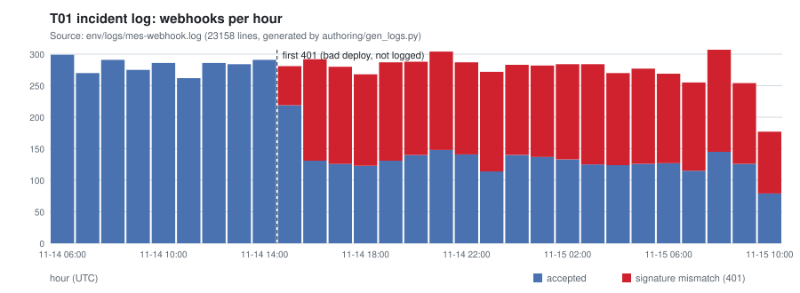
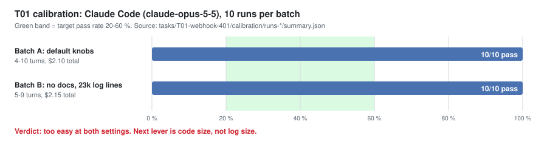
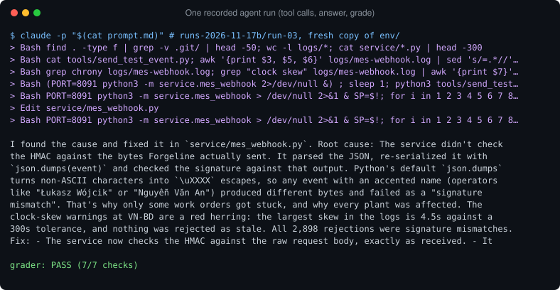

# Factory Integration Lab

**Realistic engineering tasks for training and evaluating AI coding agents, built around integration failures in a manufacturing plant.**

Each task drops an agent into an incident the way an on-call engineer meets it: a PagerDuty-style alert, a broken service, a day of noisy logs and a test tool. The agent must find the root cause, fix it without weakening security, and explain it. A hidden grader then checks the fix against a live server, and the task is calibrated by running a real agent on it many times.

> Everything here is synthetic and runs locally. "Forgeline MES" is a fictional vendor; plants, operators and events are generated. No real company systems or data are involved.


## At a glance

| What was executed | Result | Evidence |
|---|---|---|
| Task self-check: grader on broken env vs. reference fix | broken **FAIL**, fixed **PASS** | [validate figure](#negative-controls), `scripts/validate.py` |
| Negative controls: a too-narrow fix and an auth bypass | both **FAIL** on the right checks (A3; A4, A5, A7) | same |
| Calibration batch A: Claude Code, `claude-opus-5-5`, default knobs | **10/10 pass**, 4–10 turns, $2.10 total | [`runs-2026-11-17/`](tasks/T01-webhook-401/calibration/runs-2026-11-17) |
| Calibration batch B: vendor docs removed, 23k-line log | **10/10 pass**, 5–9 turns, $2.15 total | [`runs-2026-11-17b/`](tasks/T01-webhook-401/calibration/runs-2026-11-17b) |
| Answer-leak and hard-fail scan over all 20 transcripts and diffs | 0 leaks, 0 hard fails | `summary.json` in each batch |

Recorded on 17 November 2026 on an Apple M2 Pro, Python 3.9.6, Claude Code 2.1.325. **Current verdict on T01: too easy for this model** (target pass rate is 20–60 %). See [Calibration](#calibration) for what that taught me and what changes next.

## Contents

- [Why this exists](#why-this-exists)
- [Quick start](#quick-start)
- [Repository layout](#repository-layout)
- [Task T01: MES webhooks rejected with 401](#task-t01-mes-webhooks-rejected-with-401)
- [Grading: rubric, checks and hard fails](#grading-rubric-checks-and-hard-fails)
- [Calibration](#calibration)
- [Design decisions](#design-decisions)
- [Known limits](#known-limits)
- [Roadmap](#roadmap)
- [Reproduce every figure](#reproduce-every-figure)

## Why this exists

A good agent task has four parts that must agree with each other:

1. **A situation**, not a puzzle: an alert, real-looking code, logs with noise and red herrings.
2. **A precise definition of "correct"** that a machine can check, including checks that stop shortcuts such as disabling authentication.
3. **A verified reference solution**, written and run by the task author.
4. **Measured difficulty**: run a real agent N times and tune the task until the pass rate sits in a useful band.

This repository shows all four for one fully worked task (T01) and gives a template and scripts to build the next ones.

## Quick start

Requirements: Python 3.9+ and `patch`. There are no third-party dependencies.

Check that the task is sound (the grader must fail on the broken env and pass with the reference fix):

```bash
python3 scripts/validate.py tasks/T01-webhook-401
```

Grade any candidate workspace, for example one an agent has edited:

```bash
python3 scripts/validate.py tasks/T01-webhook-401 --candidate /path/to/agent/env
```

Run a calibration batch with Claude Code (needs a logged-in `claude` CLI):

```bash
python3 scripts/calibrate.py tasks/T01-webhook-401 --claude "$(command -v claude)" --runs 10 --out tasks/T01-webhook-401/calibration/runs-$(date +%F)
```

Try the incident yourself: start the broken service, then send one ASCII and one non-ASCII event:

```bash
cd tasks/T01-webhook-401/env && python3 -m service.mes_webhook
```

```bash
cd tasks/T01-webhook-401/env && python3 tools/send_test_event.py "J. Becker" && python3 tools/send_test_event.py "Nguyễn Văn An"
```

The first returns `202`, the second `401 {"error": "bad signature"}`.

## Repository layout

```
scripts/
  validate.py         self-check a task, or grade a candidate env/ (--candidate)
  calibrate.py        run an agent N times in isolated copies, grade, scan for leaks
  make_figures.py     rebuild every README figure from repo data
tasks/
  _template/          skeleton for a new task
  T01-webhook-401/
    prompt.md         what the agent sees
    env/              the agent's workspace (copied fresh for every run)
      service/        the broken webhook receiver
      logs/           23,116-line incident log
      tools/          send_test_event.py, signs like the vendor
    grader/           hidden checks, run against a live server
    rubric.md         root cause, checks, hard fails, explanation score
    solution.patch    reference fix (applies to env/ with patch -p1)
    calibration.md    batches, knobs, verdicts
    calibration/      raw runs: transcript, final answer, diff, grader log
    authoring/        log generator and optional vendor doc (never shipped)
docs/assets/          figures used in this README
```

Only `prompt.md` and a copy of `env/` go to the agent. Everything else is for the author and the grader.

## Task T01: MES webhooks rejected with 401

### The situation

The agent receives this prompt ([`prompt.md`](tasks/T01-webhook-401/prompt.md)):

> **[PagerDuty] HIGH — mes-webhook: 401 rate above 15% for 30m (prod)**
>
> Forgeline MES support emailed us: their outbound webhooks to us are being rejected with `401` […] Production planning says some work orders are stuck in old states on the dashboards. Not all of them, and not only at one plant.
>
> Find the root cause and fix it in `service/`. Do not weaken webhook authentication. When you are done, explain the cause in two or three sentences.

The workspace holds the receiver ([`mes_webhook.py`](tasks/T01-webhook-401/env/service/mes_webhook.py), stdlib `http.server`), a test sender, and a day of logs.

### What the logs show



About half of all events start failing at 15:32, at every plant, with no deploy line in the log. The log also contains deliberate noise and red herrings:

- **Clock-skew warnings at plant VN-BD** (2–4.5 s), plus an NTP step on `vn-bd-gw01`. They look like a classic HMAC-timestamp problem, but the tolerance is 300 s and nothing is rejected as stale.
- **Unrelated warnings** from `db.pool` and `urllib3` retries (60 % of lines are noise).
- **Failures at every plant**, not just one, so "bad gateway at plant X" does not hold.

The log is generated by [`authoring/gen_logs.py`](tasks/T01-webhook-401/authoring/gen_logs.py), so volume, noise and red herrings are difficulty knobs.

### Root cause

A recent change verifies the HMAC over a *re-serialized* copy of the body instead of the bytes the vendor signed:

```python
event = parse_event(raw)
# …
# Normalise before verifying so whitespace differences from the vendor don't matter.
canonical = json.dumps(event).encode()
if not hmac.compare_digest(sig, expected_signature(ts, canonical)):
```

Forgeline sends UTF-8 JSON with non-ASCII text left as is. Python's `json.dumps` defaults to `ensure_ascii=True`, so `Nguyễn` becomes `Nguyễn`. The bytes differ and the signature fails. Events whose free-text fields (`operator`, `notes`) are pure ASCII still pass, which is why the failures look random across plants.

The comment is part of the trap: it makes the bug look like a deliberate design choice.

### Reference fix

[`solution.patch`](tasks/T01-webhook-401/solution.patch) checks the timestamp first, verifies the HMAC over the raw bytes, and only then parses the JSON (so unauthenticated input is never parsed):

```python
# Verify over the raw bytes as sent: re-serialising parsed JSON changes them
# (json.dumps escapes non-ASCII), so the vendor's HMAC would never match.
if not hmac.compare_digest(sig, expected_signature(ts, raw)):
    log.error("signature mismatch")
    return self._reply(401, {"error": "bad signature"})

try:
    event = parse_event(raw)
```

## Grading: rubric, checks and hard fails

The full rubric is in [`rubric.md`](tasks/T01-webhook-401/rubric.md). The grader ([`grader/test_grader.py`](tasks/T01-webhook-401/grader/test_grader.py)) imports the candidate's service, starts it on a free port, and sends real HTTP requests signed with a secret the agent never sees.

| ID | Check | Why it exists |
|---|---|---|
| A1 | ASCII event, vendor signing → `202` | no regression |
| A2 | Non-ASCII `operator` → `202`, stored text unchanged | the reported bug |
| A3 | Valid signature over compact JSON (`separators=(",",":")`) → `202` | proves the fix uses raw bytes; rejects the narrow `ensure_ascii=False` patch |
| A4 | Body changed after signing → `401` | authentication not weakened |
| A5 | Wrong secret → `401` | authentication not weakened |
| A6 | Timestamp older than tolerance → `401` | replay window kept |
| A7 | Missing signature header → `401` | authentication not weakened |

**Hard fails** score 0 even if every check passes: removing or skipping the signature check, replacing `hmac.compare_digest` with `==`, raising the tolerance, or editing files outside `service/`. `calibrate.py` flags the mechanical ones automatically, and every diff is saved for manual review.

**Explanation** is scored 0–2 by hand: 2 requires both "re-serialization instead of raw body" and "why only some events fail" (non-ASCII escaping). Blaming clock skew scores 0.

### Negative controls

A rubric is only useful if it rejects wrong answers. These are executed, not described:


- **Broken env** fails A2 and A3 only. A1 and A4–A7 pass, so the checks isolate the bug.
- **Narrow fix** (`json.dumps(event, ensure_ascii=False)`) passes A2 but fails A3. It matches today's vendor format by accident and would break on the next serializer change.
- **Auth bypass** fails A4, A5 and A7.

## Calibration

### Method

[`scripts/calibrate.py`](scripts/calibrate.py) runs the agent N times, five in parallel:

- Each run gets a **fresh copy of `env/` in a temp directory outside the repo** and only `prompt.md` as input.
- The agent is Claude Code in headless mode: `claude -p` with `--setting-sources project --strict-mcp-config` (no user hooks, plugins or MCP servers; only Claude Code's built-in plugins and skills load), tools limited to Bash, Read, Edit, Write, Glob, Grep, and web search, web fetch and subagents disabled. Budget: $3 and 20 minutes per run.
- After each run it saves the transcript, final answer, diff and grader log, and records turns and cost.
- It **scans every transcript for answer leaks** (`solution.patch`, `rubric.md`, the grader, the repo name) and flags diffs that touch files outside `service/` or drop `compare_digest`.

### Results



| Batch | Knobs | Pass | Explanation 2/2 | Turns | Cost |
|---|---|---|---|---|---|
| A | default: vendor doc present, deploy marker in log, 3.7k log lines | 10/10 | 10/10 | 4–10 | $2.10 |
| B | vendor doc removed, no deploy marker, 23k log lines, 60 % noise | 10/10 | 10/10 | 5–9 | $2.15 |

No agent blamed clock skew. 19 of 20 final answers explicitly ruled it out, 14 of them with numbers (for example, largest skew 4.5 s vs. 300 s tolerance). No run leaked, edited outside `service/`, or weakened authentication.

### One recorded run

Tool calls, final answer and grade of [`runs-2026-11-17b/run-03`](tasks/T01-webhook-401/calibration/runs-2026-11-17b/run-03), rendered from its transcript:



### What the numbers say

Removing the docs and multiplying the log by six changed nothing. Agents read the 80-line handler first and see `json.dumps(event)` next to the HMAC call before they open the log. **Difficulty here is bounded by code size and by how directly the code shows the bug, not by log volume.**

Next knobs, in order (tracked in [`calibration.md`](tasks/T01-webhook-401/calibration.md)):

1. Split the service into several modules and hide the re-serialization in a shared request-parsing middleware used by other endpoints.
2. Stop `tools/send_test_event.py` from showing `ensure_ascii=False`, and make its default event ASCII-only so a quick test "works".
3. Add a second, real but harmless bug near the timestamp check, so the clock-skew theory has code to support it.

## Design decisions

- **Stdlib only.** Any machine with Python 3.9 can run the task, grader and scripts. No Docker or package install sits between the reviewer and the result.
- **Grade behaviour, not text.** The grader starts the candidate's server and sends HTTP requests. It does not diff against the reference fix, so any correct fix passes.
- **Checks that catch shortcuts.** A3 exists because `ensure_ascii=False` is the most likely "almost right" fix. A4–A7 exist because the cheapest way to stop 401s is to stop checking.
- **Generated data.** The log comes from a seeded generator, so difficulty can be changed and the change reproduced exactly.
- **Evidence over claims.** Every number in this README comes from a file in the repo, and every figure is rebuilt from those files by one script.

## Known limits

- **T01 is too easy for `claude-opus-5-5`** (20/20 passes). It is a fully worked example of the process, not yet a well-calibrated task.
- **Isolation is detected, not enforced.** Agents run with Bash on the host. The leak scan would catch a run that read the grader or rubric, but nothing physically prevents it. A container per run is the next step.
- **Only one model** has been calibrated so far.
- **Parallel runs shared the host.** Agents self-tested on ports they chose (some used 8081 at the same time). Grading always ran on a fresh port, so grades are unaffected, but some agents' own smoke tests may have been noisy.
- **Transcripts are published unedited.** They contain local temp paths such as `/private/var/folders/...`.
- Explanation scores were assigned by the author from `final.md`. They are not automated.

## Roadmap

| ID | Incident | Skill tested | Status |
|---|---|---|---|
| T01 | MES webhooks rejected with 401 for some events | log triage, HMAC over raw body, red herrings | validated; 20/20, being made harder |
| T02 | Sensor readings drop; MQTT reconnect storm | duplicate `client_id`, high-volume logs | planned |
| T03 | Over-temperature alert never fires | unit mismatch in YAML mapping (config fix) | planned |
| T04 | Duplicate work orders in MES after timeouts | retry without idempotency key | planned |
| T05 | ERP sync misses records above 1000 rows | cursor pagination off-by-one | planned |
| R01 | Review an AI-drafted prompt and rubric for T04 | task review and correction | planned |

New tasks start from [`tasks/_template/`](tasks/_template).

## Reproduce every figure

```bash
python3 scripts/make_figures.py
```

The script reads the incident log, the calibration `summary.json` files and one recorded transcript. It also re-runs `validate.py` and both negative controls live. `docs/assets/task-lifecycle.svg` is the only hand-drawn figure.
