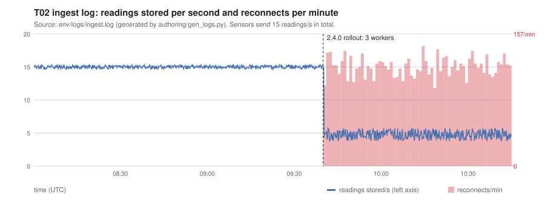
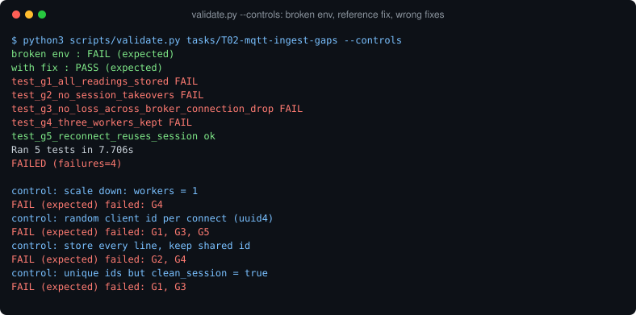
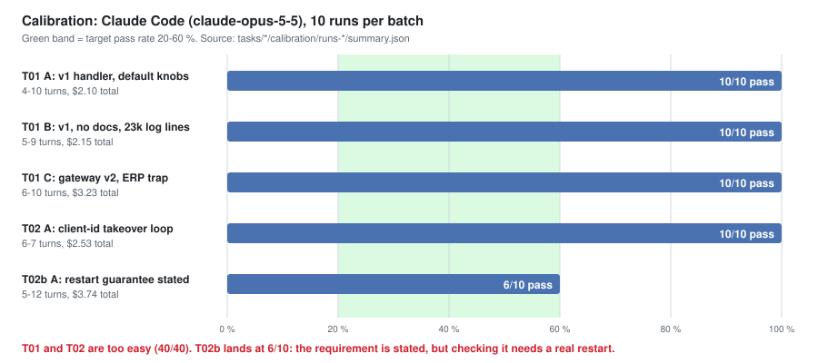
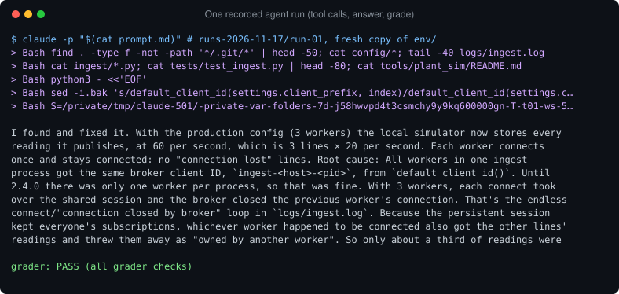

# Factory Integration Lab

**Realistic engineering tasks for training and evaluating AI coding agents, built around integration failures in a manufacturing plant.**

Each task drops an agent into an incident the way an on-call engineer meets it: a PagerDuty-style alert, a broken service with its own test suite, a day of noisy logs and a replay tool. The agent must find the root cause, fix it without weakening security or breaking other integrations, and explain it. A hidden grader then checks the fix against a live server, and the task is calibrated by running a real agent on it many times.

> Everything here is synthetic and runs locally. "Forgeline MES" is a fictional vendor; plants, operators and events are generated. No real company systems or data are involved.


## At a glance

| What was executed | Result | Evidence |
|---|---|---|
| T01 and T02 self-check: hidden grader on broken env vs. reference fix | broken **FAIL**, fixed **PASS** (visible tests also green) | `validate.py --controls`, [T01](#negative-controls), [T02](#t02-negative-controls) |
| Negative controls: 3 wrong fixes for T01, 4 for T02 | all 7 **FAIL** on the intended checks | same |
| T02 grader stability (it runs a live broker with timing) | reference fix 5/5 PASS, broken env 3/3 FAIL on the same checks | [`T02 calibration.md`](tasks/T02-mqtt-ingest-gaps/calibration.md) |
| T01 calibration, 3 batches: Claude Code, `claude-opus-5-5` | **30/30 pass**, 4–10 turns, $7.48 | [`T01 calibration/`](tasks/T01-webhook-401/calibration) |
| T02 calibration, 1 batch | **10/10 pass**, 6–7 turns, $2.53 | [`T02 calibration/`](tasks/T02-mqtt-ingest-gaps/calibration) |
| Answer-leak and hard-fail scan over all 40 transcripts and diffs | 0 leaks, 0 hard fails | `summary.json` in each batch |

Recorded on 17 November 2026 on an Apple M2 Pro, Python 3.9.6, Claude Code 2.1.325. **Current verdict: both tasks are too easy for this model** (40/40; target pass rate is 20–60 %). They stay as fully documented reference tasks. T02 also surfaced a real quality gap the grader does not score (see [T02 calibration](#t02-calibration)), which defines the next, harder variant.

## Contents

- [Why this exists](#why-this-exists)
- [Quick start](#quick-start)
- [Repository layout](#repository-layout)
- [Task T01: MES webhooks rejected with 401](#task-t01-mes-webhooks-rejected-with-401)
- [Grading: rubric, checks and hard fails](#grading-rubric-checks-and-hard-fails)
- [Task T02: sensor ingest stores a third of the readings](#task-t02-sensor-ingest-stores-a-third-of-the-readings)
- [Calibration](#calibration)
- [Design decisions](#design-decisions)
- [Known limits](#known-limits)
- [Roadmap](#roadmap)
- [Reproduce every figure](#reproduce-every-figure)

## Why this exists

A good agent task has four parts that must agree with each other:

1. **A situation**, not a puzzle: an alert, real-looking code with tests, logs with noise and red herrings.
2. **A precise definition of "correct"** that a machine can check, including checks that stop shortcuts such as disabling authentication or breaking a neighbouring integration.
3. **A verified reference solution**, written and run by the task author.
4. **Measured difficulty**: run a real agent N times and tune the task until the pass rate sits in a useful band.

This repository shows all four for two fully worked tasks (T01, T02) and gives a template and scripts to build the next ones.

## Quick start

Requirements: Python 3.9+ and `patch`. There are no third-party dependencies.

Check that a task is sound: the grader must fail on the broken env, pass with the reference fix, and fail every plausible wrong fix in `authoring/negative_controls.json`:

```bash
python3 scripts/validate.py tasks/T01-webhook-401 --controls
```

```bash
python3 scripts/validate.py tasks/T02-mqtt-ingest-gaps --controls
```

Grade any candidate workspace, for example one an agent has edited:

```bash
python3 scripts/validate.py tasks/T01-webhook-401 --candidate /path/to/agent/env
```

Run a calibration batch with Claude Code (needs a logged-in `claude` CLI):

```bash
python3 scripts/calibrate.py tasks/T01-webhook-401 --claude "$(command -v claude)" --runs 10 --out tasks/T01-webhook-401/calibration/runs-$(date +%F)
```

Try the incident yourself. Start the broken gateway:

```bash
cd tasks/T01-webhook-401/env && python3 -m service.app
```

In a second terminal, replay the captured ASCII event, then the same event with a Vietnamese operator name:

```bash
cd tasks/T01-webhook-401/env && python3 tools/send_test_event.py && python3 tools/send_test_event.py --file <(sed 's/J. Becker/Nguyễn Văn An/' tools/samples/work_order_updated.json)
```

The first returns `202`, the second `401 {"error": "bad signature"}`. The visible test suite is green on this broken code:

```bash
cd tasks/T01-webhook-401/env && python3 -m unittest discover -s tests -v
```

Try T02: start the plant simulator (broker plus sensors for lines 1–3):

```bash
cd tasks/T02-mqtt-ingest-gaps/env && python3 tools/plant_sim/run.py
```

In a second terminal, run the broken ingest service. The simulator terminal fills with `taking over session` warnings, and the service stores about a third of the 60 readings/s:

```bash
cd tasks/T02-mqtt-ingest-gaps/env && python3 -m ingest.main --config config/ingest.ini
```

## Repository layout

```
scripts/
  validate.py         self-check a task (--controls runs the wrong fixes too), or grade a candidate env/
  calibrate.py        run an agent N times in isolated copies, grade, scan for leaks (--summarise-only rebuilds results)
  make_figures.py     rebuild every README figure from repo data
tasks/
  _template/          skeleton for a new task
  T01-webhook-401/
    prompt.md         what the agent sees
    env/              the agent's workspace (copied fresh for every run)
      service/        integration gateway: app, middleware, signing, store, handlers/{mes,erp}
      tests/          visible test suite (green on the broken code)
      docs/           internal doc for the ERP connector
      logs/           23,158-line incident log
      tools/          replay tool and a captured Forgeline delivery
    grader/           hidden checks A1-A9, run against a live server
    rubric.md         root cause, traps, checks, hard fails, explanation score
    solution.patch    reference fix (applies to env/ with patch -p1)
    calibration.md    batches, knobs, verdicts
    calibration/      raw runs: transcript, final answer, diff, grader log
    authoring/        log generator, negative_controls.json, optional vendor doc (never shipped)
  T02-mqtt-ingest-gaps/
    env/
      ingest/         sensor ingest service: config, broker client, worker threads, SQLite store
      config/         ingest.ini (3 workers since 2.4.0)
      tests/          visible tests (green on the broken code)
      logs/           16,365-line service log around the 2.4.0 rollout
      tools/plant_sim/ broker simulator with MQTT session rules, simulated line sensors
    grader/           hidden checks G1-G5: runs the candidate against the task's own broker
    ...               same files as T01
docs/assets/          figures used in this README
```

Only `prompt.md` and a copy of `env/` go to the agent. Everything else is for the author and the grader.

## Task T01: MES webhooks rejected with 401

### The situation

The agent receives this prompt ([`prompt.md`](tasks/T01-webhook-401/prompt.md)):

> **[PagerDuty] HIGH — mes-webhook: 401 rate above 15% for 30m (prod)**
>
> Forgeline MES support emailed us: their outbound webhooks to us are being rejected with `401` […] Production planning says some work orders are stuck in old states on the dashboards. Not all of them, and not only at one plant.
>
> Find the root cause and fix it. Do not weaken webhook authentication. When you are done, explain the cause in two or three sentences.

The workspace is a small integration gateway (about 230 lines, stdlib `http.server`) that receives webhooks from two connectors:

| Route | Sender | How it signs |
|---|---|---|
| `/webhooks/mes` | Forgeline MES (external vendor) | HMAC-SHA256 over the **bytes it sends** |
| `/webhooks/erp` | in-house ERP connector | HMAC-SHA256 over **`json.dumps(payload)`**, not the wire bytes ([`docs/erp-connector.md`](tasks/T01-webhook-401/env/docs/erp-connector.md)) |

Both routes go through one shared middleware that parses and re-encodes the body.

### What the logs show


About half of all MES events start failing at 15:36, at every plant, with no deploy line in the log. The log also carries deliberate noise and red herrings:

- **Clock-skew warnings at plant VN-BD** (2–4.5 s) and an NTP step on `vn-bd-gw01`. They look like a classic HMAC-timestamp problem, but the tolerance is 300 s and nothing is rejected as stale.
- **Unrelated lines** from `db.pool`, `urllib3` retries and the healthy ERP route (60 % of lines are noise).
- **Failures at every plant**, so "bad gateway at plant X" does not hold.

The log comes from [`authoring/gen_logs.py`](tasks/T01-webhook-401/authoring/gen_logs.py), so volume, noise and red herrings are difficulty knobs.

### Root cause

The shared middleware re-encodes every body ([`middleware.py`](tasks/T01-webhook-401/env/service/middleware.py)):

```python
# Connectors send pretty-printed JSON with CRLFs (ERP) or compact JSON (MES).
# Re-encode once so signature checks, dedup hashes and audit logs all see one form.
body = json.dumps(data).encode()
```

and the MES handler verifies Forgeline's signature over that re-encoded copy ([`handlers/mes.py`](tasks/T01-webhook-401/env/service/handlers/mes.py)):

```python
skew = signing.verify_mes(req.headers, req.body)
```

Forgeline sends UTF-8 JSON with non-ASCII text left as is. `json.dumps` defaults to `ensure_ascii=True`, so `Nguyễn` becomes `Nguyễn`, the bytes differ and the signature fails. Events whose free-text fields (`operator`, `notes`) are pure ASCII still pass, which is why the failures look random across plants.

**The re-encoding is not itself the bug.** The ERP connector signs exactly that re-encoded form, so the ERP route depends on it. The fix has to separate the two senders, not remove the middleware step.

### Traps

| Trap | Where | What a weak fix does |
|---|---|---|
| Clock skew at VN-BD, NTP step | log | raises tolerance or blames NTP |
| `check_timestamp` has no `abs()` (future-dated requests are never rejected) | `signing.py` | fixes that real but unrelated bug and stops |
| ERP depends on the re-encoding | `middleware.py`, `docs/` | passes raw bytes to every route and breaks ERP |
| The captured sample is ASCII-only | `tools/samples/` | "cannot reproduce, works for me" |
| Visible MES tests sign `json.dumps` output | `tests/` | test suite is green on the broken code |

### Reference fix

[`solution.patch`](tasks/T01-webhook-401/solution.patch) keeps the raw bytes on the request next to the re-encoded body, and verifies MES over the raw bytes. ERP is untouched:

```python
# middleware.py
self.raw = raw  # bytes exactly as received; what senders that sign the wire sign
...
return Request(handler.path, handler.headers, body, data, raw)

# handlers/mes.py
# Forgeline signs the body exactly as sent, not our re-encoded copy.
skew = signing.verify_mes(req.headers, req.raw)
```

## Grading: rubric, checks and hard fails

The full rubric is in [`rubric.md`](tasks/T01-webhook-401/rubric.md). The grader ([`grader/test_grader.py`](tasks/T01-webhook-401/grader/test_grader.py)) imports the candidate's gateway, starts it on a free port, and sends real HTTP requests signed with secrets the agent never sees.

| ID | Check | Why it exists |
|---|---|---|
| A1 | MES ASCII event, Forgeline signing → `202` | no regression |
| A2 | MES non-ASCII `operator` → `202`, stored text unchanged | the reported bug |
| A3 | MES valid signature over compact JSON → `202` | proves raw-byte verification; rejects the narrow `ensure_ascii=False` patch |
| A4 | MES body changed after signing → `401` | authentication not weakened |
| A5 | MES wrong secret → `401` | authentication not weakened |
| A6 | MES timestamp older than tolerance → `401` | replay window kept |
| A7 | MES missing signature header → `401` | authentication not weakened |
| A8 | ERP pretty-printed CRLF body with non-ASCII, signed per connector docs → `202` | the other connector still works |
| A9 | ERP wrong secret → `401` | ERP authentication not weakened |

**Hard fails** score 0 even if every check passes: removing or skipping a signature check, replacing `hmac.compare_digest` with `==`, raising the tolerance, deleting or weakening existing tests, or editing files outside `service/` and `tests/`. `calibrate.py` flags the mechanical ones and saves every diff for review.

**Explanation** is scored 0–2 by hand: 2 requires both "verified over re-encoded JSON instead of raw bytes" and "why only some events fail" (non-ASCII escaping). Blaming clock skew scores 0.

### Negative controls

A rubric is only useful if it rejects wrong answers. These are executed, not described:


- **Broken env** fails A2 and A3 only, so the checks isolate the bug.
- **Narrow fix** (`ensure_ascii=False` in the middleware) passes A2 but fails A3 and A8: it matches today's vendor format by accident and breaks the ERP signature.
- **Global fix** (middleware hands raw bytes to every route) fixes MES and fails A8. The visible ERP test also fails, so an agent that runs the tests can see it.
- **Auth bypass** fails A4, A5 and A7.

## Task T02: sensor ingest stores a third of the readings

### The situation

The agent receives a Grafana alert ([`prompt.md`](tasks/T02-mqtt-ingest-gaps/prompt.md)): readings stored per minute at the Düsseldorf plant dropped 67 % after this morning's ingest 2.4.0 rollout. Every line still gets some readings. The sensors and the plant broker look healthy, and the release's worker scale-up is needed for line 3.

The workspace is a small sensor ingest service (stdlib, threads, SQLite) that subscribes to an MQTT-style broker, plus a **plant simulator** in `tools/plant_sim/`: a broker that follows MQTT 3.1.1 session rules and simulated sensors for lines 1–3. This task was built after T01's lesson: **the evidence should only appear when the system runs**, not in one readable line of code.

### What the log shows



At 09:40 the rate drops from 15 to about 5 readings/s and the log fills with `connection lost (connection closed by broker); reconnecting in 0.2s`, alternating between the three workers. Nothing in the log says why the broker closes the connections, and no line mentions dropped readings.

### Root cause

Release 2.4.0 runs three worker threads in one process. Each builds its client id with:

```python
def default_client_id(prefix):
    # One stable id per ingest process, so the broker keeps our session (and
    # queues readings) across reconnects when clean_session is false.
    return "%s-%s-%d" % (prefix, socket.gethostname(), os.getpid())
```

The pid looks unique, but the workers are threads of the same process, so all three share one id. MQTT allows one live connection per client id: every CONNECT takes the session over and the broker closes the previous worker's connection. That worker reconnects 0.2 s later (the backoff resets after each successful connect) and kicks the next one, forever.

With `clean_session = false` the shared session collects all three subscriptions, so the worker holding it receives every line. Each worker stores only its own line and skips the rest **at DEBUG level**, which never reaches the production log. About one third of readings survive, spread over all lines.

### Traps

| Trap | Where | What a weak fix does |
|---|---|---|
| "connection closed by broker" | log | tunes backoff or keepalive, blames the broker |
| `keepalive` lowered from 60 to 10 in the same release | `config/ingest.ini` | reverts keepalive; nothing changes |
| Comment says "one stable id per process" | `mqtt_client.py` | the pid looks unique |
| Skipped readings logged at DEBUG | `worker.py` | the log shows no data loss |
| End-to-end test uses `workers = 1` | `tests/` | test suite is green on the broken code |

### Reference fix

[`solution.patch`](tasks/T02-mqtt-ingest-gaps/solution.patch) gives each worker its own client id that stays the same across reconnects **and process restarts**:

```python
def default_client_id(prefix, worker_index):
    # One id per worker connection. MQTT allows one live connection per client id: workers
    # sharing an id take each other's session over in a loop. The id must also stay the same
    # across reconnects and restarts, so the broker keeps the session and queues readings.
    return "%s-%s-w%d" % (prefix, socket.gethostname(), worker_index)
```

### T02 grading

The grader ([`grader/test_grader.py`](tasks/T02-mqtt-ingest-gaps/grader/test_grader.py)) starts the **task's own** broker simulator (an agent cannot pass by editing `tools/`), runs the candidate's service with the candidate's config, publishes 100 readings/s per line, closes every ingest connection once mid-run (sessions kept, like a load-balancer failover), and then reads the candidate's SQLite store.

| ID | Check | Why it exists |
|---|---|---|
| G1 | ≥ 99 % of published readings stored | the reported symptom |
| G2 | zero session takeovers at the broker | root cause removed, not masked |
| G3 | ≥ 99 % of readings published 0.02–0.6 s after the drop stored | session survives a reconnect (stable id, `clean_session = false`) |
| G4 | config keeps `workers = 3`, `lines = 1,2,3`; at least 3 broker sessions | the scale-up is kept |
| G5 | at most 3 distinct ingest client ids over the run | ids do not change on reconnect |

Hard fails: fewer workers, removing per-worker line ownership while ids are still shared, weakening existing tests, or changing `tools/plant_sim/`. Full rubric: [`rubric.md`](tasks/T02-mqtt-ingest-gaps/rubric.md).

### T02 negative controls



- **`workers = 1`** removes the symptom and fails G4.
- **A random uuid per connect** stops the takeovers but loses readings during the failover window: fails G1, G3, G5.
- **Storing every line with the shared id** hides the data loss but the takeover loop continues: fails G2, G4.
- **Unique ids with `clean_session = true`** loses readings published while reconnecting: fails G1, G3.

## Calibration

### Method

[`scripts/calibrate.py`](scripts/calibrate.py) runs the agent N times, five in parallel:

- Each run gets a **fresh copy of `env/` in a temp directory outside the repo** and only `prompt.md` as input.
- The agent is Claude Code in headless mode: `claude -p` with `--setting-sources project --strict-mcp-config` (no user hooks, plugins or MCP servers; only Claude Code's built-in plugins and skills load), tools limited to Bash, Read, Edit, Write, Glob, Grep, and web search, web fetch and subagents disabled. Budget: $3 and 20 minutes per run.
- After each run it saves the transcript, final answer, diff and grader log, records turns and cost, and re-runs the visible test suite.
- It **scans every transcript for answer leaks** (`solution.patch`, `rubric.md`, the grader, the repo name) and records which files each run changed, so hard fails can be reviewed. `--summarise-only` rebuilds the results from saved artifacts.

### Results



| Batch | Env and knobs | Pass | Explanation 2/2 | Turns | Cost |
|---|---|---|---|---|---|
| T01 A | v1: single 80-line handler, vendor doc, deploy marker, 3.7k log lines | 10/10 | 10/10 | 4–10 | $2.10 |
| T01 B | v1, vendor doc removed, no deploy marker, 23k log lines, 60 % noise | 10/10 | 10/10 | 5–9 | $2.15 |
| T01 C | v2: gateway package, ERP trap, `abs()` lure, ASCII-only sample, green visible tests | 10/10 | 10/10 | 6–10 | $3.23 |
| T02 A | default: takeover loop, DEBUG-only drops, keepalive lure | 10/10 | 10/10 | 6–7 | $2.53 |

What the agents did in T01 batch C:

- All 10 verified MES over raw bytes and kept the re-encoded body for ERP, the same shape as the reference fix. None tried the global fix, and none touched the `abs()` lure.
- All 10 added regression tests (raw UTF-8, compact JSON, tampered body). No existing assertion was removed; the two changed lines per run widen a test helper to accept a raw body.
- No agent blamed clock skew in any batch.

### T02 calibration

- All 10 gave each worker its own id, kept 3 workers and `clean_session = false`, added a 3-worker end-to-end test, and left `tools/` alone. Visible tests are green in all 10 (re-run on workspaces rebuilt from each `diff.patch`).
- **All 10 kept the pid in the id** (`<prefix>-<host>-<pid>-w<N>`). That passes every check, because the ids are stable across reconnects. But they change on every process restart, so the persistent session and its queued readings are orphaned on each deploy. The reference fix drops the pid. Only 2 of 10 runs flagged this in their answer, as a follow-up.
- The prompt never states a restart requirement, so this is recorded as a finding, not scored after the fact. It defines the next variant: state the requirement and add a check that restarts the candidate process mid-run.

### One recorded run

Tool calls, final answer and grade of [`runs-2026-11-17c/run-03`](tasks/T01-webhook-401/calibration/runs-2026-11-17c/run-03), rendered from its transcript:


And T02 [`runs-2026-11-17/run-01`](tasks/T02-mqtt-ingest-gaps/calibration/runs-2026-11-17/run-01):



### What the numbers say

- **Log volume and missing docs changed nothing** (A → B). Agents read the code before the logs.
- **More code and a cross-route trap raised cost by 50 % and average turns from 7.2 to 8.1** (B → C) **but caused no failures.** The agent read `docs/erp-connector.md`, saw the dependency, and scoped the fix to MES.
- **HMAC over re-serialized JSON is a well-known bug class.** Once the agent sees `json.dumps` near an HMAC check, decoys around it do not help.

- **Moving the evidence into runtime behaviour (T02) did not make it hard either.** The takeover loop is obvious in the log, and the simulator reproduces it in seconds. Runs took 6–7 turns, the narrowest spread of any batch.
- **Where the model fell short was an unstated requirement, not the diagnosis.** In T02 every run fixed the incident, but all 10 left a durability gap that an experienced engineer would check before shipping, and only 2 noticed it.

So T01 and T02 stay as easy, fully documented reference tasks. The next difficulty lever is tasks whose correct fix depends on a non-functional requirement the agent must uphold (durability across restarts, idempotency under retries), checked by the grader and stated in the prompt. Batch notes: [`T01 calibration.md`](tasks/T01-webhook-401/calibration.md), [`T02 calibration.md`](tasks/T02-mqtt-ingest-gaps/calibration.md). The T01 v1 environment used in batches A and B is in the git history.

## Design decisions

- **Stdlib only.** Any machine with Python 3.9 can run the task, grader and scripts. No Docker or package install sits between the reviewer and the result.
- **Grade behaviour, not text.** The grader starts the candidate's server and sends HTTP requests. It does not diff against the reference fix, so any correct fix passes.
- **Checks that catch shortcuts.** Every task ships `authoring/negative_controls.json`: plausible wrong fixes that `validate.py --controls` applies and expects to fail. A3 exists because `ensure_ascii=False` is the most likely "almost right" fix. A8 exists because removing the re-encoding everywhere is the most likely "too broad" fix. A4–A7 and A9 exist because the cheapest way to stop 401s is to stop checking.
- **The grader owns the infrastructure.** T02's grader runs its own pristine broker simulator, not the candidate's copy, so a fix cannot pass by changing the test harness.
- **A visible test suite that is green on the bug.** That is how real codebases look, and it rewards agents that add a regression test.
- **Generated data.** The log comes from a seeded generator, so difficulty can be changed and the change reproduced exactly.
- **Evidence over claims.** Every number in this README comes from a file in the repo, and every figure is rebuilt from those files by one script.

## Known limits

- **Both tasks are too easy for `claude-opus-5-5`** (T01 30/30 across three settings, T02 10/10). They are fully worked examples of the process, not well-calibrated hard tasks.
- **T02's grader depends on timing** (100 readings/s, a 0.6 s failover window). It was stable on this machine (5/5 and 3/3), but a slower or heavily loaded machine could flake.
- **T02's first batch summary was rebuilt.** `calibrate.py` crashed on a T01-only check after all 10 agent runs had finished and saved their artifacts. The script was fixed and `summary.json` rebuilt with `--summarise-only`; the visible-test result was re-run on workspaces rebuilt from each diff.
- **Isolation is detected, not enforced.** Agents run with Bash on the host. The leak scan would catch a run that read the grader or rubric, but nothing physically prevents it. A container per run is the next step.
- **Only one model** has been calibrated so far.
- **Parallel runs shared the host.** Agents self-tested on ports they chose, sometimes at the same time. Grading always ran on a fresh port, so grades are unaffected, but some agents' own smoke tests may have been noisy.
- **Transcripts are published unedited.** They contain local temp paths such as `/private/var/folders/...`.
- **Answers are public.** The graders, rubrics and reference fixes are in this repo, so these tasks cannot serve as blind benchmarks from here on.
- Explanation scores were assigned by the author from `final.md`. They are not automated.

## Roadmap

| ID | Incident | Skill tested | Status |
|---|---|---|---|
| T01 | MES webhooks rejected with 401 for some events | log triage, HMAC over raw body, scoped fix across connectors | validated; 30/30, kept as reference |
| T02 | Sensor readings drop after scaling ingest workers | MQTT session takeover from a shared client id, runtime reproduction | validated; 10/10, kept as reference |
| T02b | Same incident, restart durability stated in the prompt | stable ids across process restarts (new restart check) | next |
| T03 | Over-temperature alert never fires | unit mismatch in YAML mapping (config fix) | planned |
| T04 | Duplicate work orders in MES after timeouts | retry without idempotency key | planned |
| T05 | ERP sync misses records above 1000 rows | cursor pagination off-by-one | planned |
| R01 | Review an AI-drafted prompt and rubric for T04 | task review and correction | planned |

New tasks start from [`tasks/_template/`](tasks/_template).

## Reproduce every figure

```bash
python3 scripts/make_figures.py
```

The script reads both incident logs, the calibration `summary.json` files and one recorded transcript per task. It also re-runs `validate.py` and every negative control live, for both tasks. `docs/assets/task-lifecycle.svg` is the only hand-drawn figure.
